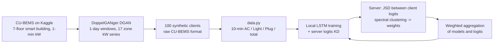

# FedWKD: Federated Learning Weighted Aggregation with Knowledge Distillation for IoT Forecasting

[](https://github.com/b-k-f/FedWKD/actions/workflows/ci.yml)
[](https://github.com/b-k-f/FedWKD/actions/workflows/experiment.yml)
[](https://doi.org/10.1016/j.iot.2025.101849)
 

**Author:** Bouchra Fakher
**Published in:** Elsevier, *Internet of Things* (2025)
**DOI:** [10.1016/j.iot.2025.101849](https://doi.org/10.1016/j.iot.2025.101849)

## Abstract

Federated Learning (FL) has emerged as a promising solution for decentralized Machine Learning (ML) for heterogeneous, non-independent and identically distributed (non-IID) time-series data. However, the traditional FL methods are prone to overfitting at the client level, which may cause privacy leakage and complicate deployment in highly sensitive data environments. In this paper, we propose a novel approach that integrates Knowledge Distillation (KD) by using distilled information of each client, named logits, alongside global distilled logits to improve local model training while also assigning importance weights for each client during aggregation of received logits and models on the server-side. The proposed method employs KD regularization techniques that align local objectives with global objectives while refraining the server (teacher) from training on a dataset on the server-side by only aggregating the received logits and models using weighted aggregation. Thus, we avoid training overhead and data leakage on the server and use weighting based on logits for each training round, achieving better convergence for non-IID data. Experimental results highlight its ability to improve forecasting metrics compared to other methods such as CADIS and FEDGKD, using loss, error, and execution time metrics, hence bettering generalization and minimizing client drift and bias.

## How it works



Each round, the server measures how different the clients' logits are (Jensen-Shannon divergence), clusters the clients, gives each client a weight from its cluster's irregularity and its data size, and aggregates both the models and the logits with those weights. The aggregated logits are sent back as the distillation target, so the server never trains on data.

## Reproduce on GitHub (no local data needed)

The dataset is downloaded from Kaggle inside GitHub Actions, so nothing large is stored in the repository.

1. Get a Kaggle API token from [kaggle.com/settings](https://www.kaggle.com/settings) ("Create New Token").
2. In this repository, open **Settings → Secrets and variables → Actions** and add:
   - secrets `KAGGLE_USERNAME` and `KAGGLE_KEY`
   - variable `KAGGLE_DATASET` = the CU-BEMS dataset slug on Kaggle (`owner/dataset-name`)
3. Open **Actions → FedWKD experiment → Run workflow**, choose the number of clients, rounds and algorithms.

The run has three stages: download and DGAN client generation, one parallel training job per algorithm, then a comparison table that appears directly on the run page. Plots and metrics are attached to the run as downloadable artifacts. The raw download and the trained DGAN are cached, so later runs skip them.

## Run locally

```bash
pip install torch --index-url https://download.pytorch.org/whl/cpu   # or the CUDA build
pip install -r requirements.txt
pip install --no-deps gretel-synthetics   # DGAN only

export KAGGLE_USERNAME=... KAGGLE_KEY=... KAGGLE_DATASET=owner/dataset-name
python scripts/download_cubems.py --out data/raw
python scripts/generate_clients.py --raw-dir data/raw --out-dir data/clients --n-clients 100
python run_experiment.py --algo fedwkd --n-clients 100 --rounds 20
python run_experiment.py --algo cadis  --n-clients 100 --rounds 20
python scripts/compare.py
```

## Repository structure

| Path | Role |
|---|---|
| `algorithm.py` | FedWKD (`fedkd`) and baselines: FedAvg, CADIS, FedGKD, FedCSA, FedLbs |
| `train.py` | Local training with KD, evaluation (sMAPE, MAE, RMSE) |
| `util.py` | JSD matrix, spectral clustering, cluster-based weights, sliding windows |
| `model.py` | LSTM forecaster |
| `data.py` | CU-BEMS preprocessing (10-min aggregation of AC, lighting, plug loads) |
| `scripts/download_cubems.py` | Kaggle download |
| `scripts/generate_clients.py` | DoppelGANger (DGAN) generation of the synthetic clients |
| `run_experiment.py` | Command-line entry point for one algorithm |
| `scripts/compare.py` | Comparison table and plots across algorithms |
| [b-k-f/FedKWD](https://github.com/b-k-f/FedKWD) | Original research notebooks |
| `.github/workflows/` | CI smoke test and the full experiment pipeline |

## Data

CU-BEMS (Pipattanasomporn et al., *Scientific Data* 7, 241, 2020) contains one-minute electricity consumption for each zone and floor of a seven-storey office building at Chulalongkorn University, broken down into air conditioning, lighting and plug loads. The synthetic clients are produced with DoppelGANger (DGAN, Lin et al. 2020), using the Gretel implementation. The DGAN is trained on one floor (2018 Floor 3 by default): the 17 zone-level kW series are cut into one-day windows of 1,440 minutes, and the trained generator produces 100 clients in the original CU-BEMS format. Training takes 10,000 epochs; the trained model is cached between workflow runs and published as a run artifact, so it is trained only once per configuration.

## Citation

```bibtex
@article{fakher2025fedwkd,
  title={FedWKD: Federated Learning Weighted Aggregation with Knowledge Distillation for IoT Forecasting},
  author={Fakher, Bouchra and Brahmia, Mohamed El Amine and Bennis, Ismail and Abouaissa, Abdelhafid},
  journal={Internet of Things},
  pages={101849},
  year={2025},
  publisher={Elsevier}
}
```
